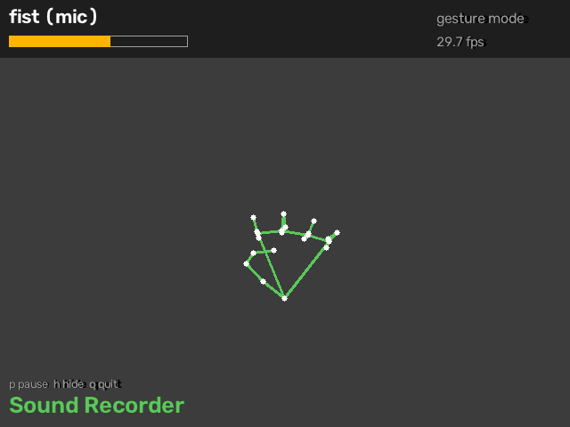
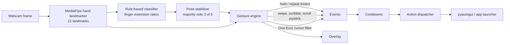

# Gesture control

[](https://github.com/Karthikeyan314/gesture-control/actions/workflows/ci.yml)

Control a Windows PC with hand gestures from your webcam. MediaPipe finds 21 hand landmarks per frame, rule-based geometry turns them into gestures, and a debounced engine maps those gestures to media keys, scrolling, window switching, a mouse cursor and app launchers. Everything runs locally, and no video leaves the machine.

It runs as a system tray app with an optional live camera overlay that shows what it sees.

## Demo



*The overlay, rendered from the `mic_grip_hold` test fixture: the detected gesture is at the top left, the bar shows how long until the hold fires, and the last action appears at the bottom.*

To capture your own demo GIF, run `uv run gesture-control --no-tray --dry-run`, record the overlay window with ShareX or the Xbox Game Bar (Win+Alt+R), and save it as `docs/demo.gif`.

## Gestures

| Gesture | How | Action (default) |
|---|---|---|
| Open palm | Hold still 0.5 s | Play/pause media |
| Thumbs up/down | Hold, repeats every 0.25 s | Volume up/down |
| Swipe right/left | Open palm moved quickly sideways | Next/previous window (Alt+Tab) |
| Peace sign | Move up or down from where you started, like a joystick | Scroll; farther means faster |
| Mic grip (closed fist) | Hold 1 s | Open Sound Recorder |
| Scribble | Wiggle a pointing finger left and right | Open OneNote (falls back to Notepad) |
| Call me (thumb and pinky) | Hold 0.6 s | Screenshot (Snipping Tool) |
| Three fingers | Hold 0.8 s | Turn mouse mode on/off |
| *Mouse mode:* point | Move your hand | Move the cursor |
| *Mouse mode:* pinch | Thumb to index; keep pinching to drag | Left button down/up |

In mouse mode every other gesture is ignored, so pointing at things can't trigger shortcuts. Every gesture, timing and action is configurable (see [configuration](#configuration)).

## Quick start

Requires Windows 10/11, Python 3.12, [uv](https://docs.astral.sh/uv/) and a webcam.

```bash
uv sync --extra app
uv run gesture-control            # tray icon plus overlay window
uv run gesture-control --dry-run  # log the actions instead of performing them
```

The first run downloads the MediaPipe hand landmarker model (about 8 MB) to `models/`. If the download is blocked:

```bash
curl.exe -L -o models/hand_landmarker.task https://storage.googleapis.com/mediapipe-models/hand_landmarker/hand_landmarker/float16/latest/hand_landmarker.task
```

The tray icon menu has pause, show/hide overlay and quit. In the overlay window, `p` pauses, `h` hides and `q` quits. Pausing releases the mouse button if a pinch was holding it.

| Command | What it does |
|---|---|
| `gesture-control` | Tray app with overlay (`--no-tray`, `--no-overlay`, `--dry-run`, `-c config.yaml`) |
| `gesture-control init-config gestures.yaml` | Write the default config to edit |
| `gesture-control record NAME --expect play_pause` | Record your own landmarks into a fixture (no actions fire) |
| `gesture-control replay FILE.json` | Run a recording through the engine and print poses, events and actions |

## How it works



- **Classification without training data.** A long finger counts as extended when its wrist-to-tip distance is at least 1.15 times its wrist-to-middle-joint distance, and the thumb has its own rule. Every threshold is a ratio of palm size, so the rules work at any distance from the camera and with the hand tilted. A pinch also needs the index fingertip held away from the palm, which stops a fist from reading as a pinch.
- **Smoothing and debouncing, in layers.** A pose must win 3 of the last 5 frames to count, so a single misread frame is ignored. Static gestures fire only after a hold, and the hold restarts if the hand moves, so an open-palm swipe never also counts as play/pause. Each binding has a cooldown, and any swipe blocks holds until the pose changes.
- **Dynamic gestures** come from short motion histories: swipes from wrist displacement within 0.6 s, scribbles from counting direction reversals larger than a minimum amplitude, and scrolling from distance to an anchor point (joystick style, so long pages don't need repeated flicks).
- **A cursor that doesn't jitter.** A One Euro filter smooths the cursor heavily at rest and lightly when moving fast. The cursor follows the index knuckle rather than the fingertip, because the knuckle stays put when you pinch, so clicks land where you aimed. A camera border is trimmed so the screen corners are reachable.
- **Testable by design.** The engine is pure Python and takes timestamps as input rather than reading a clock. Camera, MediaPipe and OS control are isolated in `detector.py`, `app.py` and `PyAutoGuiBackend`, behind an optional `app` extra. Tests replay landmark recordings into the same code that runs live.

```
src/gesture_control/
  landmarks.py      Hand container, landmark indices, skeleton
  classifier.py     Static pose rules
  smoothing.py      Pose stabilizer, One Euro filter
  motion.py         Swipe, scribble, scroll joystick, hold trigger, cooldown
  engine.py         Frames in, debounced events out
  actions.py        Event → action → backend (pyautogui or recording)
  config.py         YAML schema and validation
  default_config.yaml
  detector.py       MediaPipe Tasks wrapper, model download
  overlay.py        OpenCV overlay drawing
  app.py            CLI, camera loop, tray icon
```

## Configuration

`gesture-control init-config gestures.yaml` writes the [default config](src/gesture_control/default_config.yaml). Bind any gesture to any action:

```yaml
gestures:
  open_palm: {action: play_pause, hold: 0.5, cooldown: 1.5}
  thumbs_up: {action: volume_up, hold: 0.3, repeat: 0.25}
  fist:      {action: voice_typing, hold: 1.0, cooldown: 3.0}

actions:
  voice_typing: {type: hotkey, keys: [win, h], label: Voice typing}
  open_notes:   {type: launch, targets: ["onenote:", notepad.exe]}
```

Action types are `key`, `hotkey`, `launch` (an app, URI or `shell:AppsFolder` ID, trying each target in order), `scroll`, `move_cursor`, `mouse_down`, `mouse_up` and `click`. Detection thresholds (`classifier`, `stabilizer`, `swipe`, `scribble`, `scroll`, `mouse_mode`) live in the same file. The loader rejects unknown keys, gestures and actions with a clear error.

## Tests

```bash
uv sync
uv run pytest -q
uv run ruff check . && uv run ruff format --check .
```

76 tests run in under a second with no webcam, MediaPipe or display. Fixtures in `tests/fixtures/` are timestamped 21-landmark sequences at 30 fps, and each one declares the actions it should trigger. `test_fixtures_end_to_end.py` replays every fixture through the engine and dispatcher and checks the result: one play/pause for a 3 s palm hold, repeated volume steps for a thumbs-up, no play/pause after a swipe, nothing for quick pose changes, press-then-release in a mouse session, and so on.

The committed fixtures are synthetic, made by `scripts/make_fixtures.py`. It uses a hand skeleton with MediaPipe's landmark layout and real proportions, then adds placement, rotation, motion paths, jitter, glitch frames and dropped frames. CI regenerates them and fails if they drift. To add a real one, record it; any JSON in `tests/fixtures/` is picked up automatically:

```bash
uv run gesture-control record open_palm_real --expect play_pause --out tests/fixtures/open_palm_real.json
```

CI ([`.github/workflows/ci.yml`](.github/workflows/ci.yml)) runs ruff, runs the tests on Ubuntu and Windows, and runs the fixture-drift check.

## Roadmap

- A small trained classifier (scikit-learn on landmark features) built from `record` sessions, compared against the rules
- Two-hand gestures and left-hand mirroring options
- Per-app profiles (different bindings when a video player or browser is focused)
- Settings window for live threshold tuning

## License

MIT
